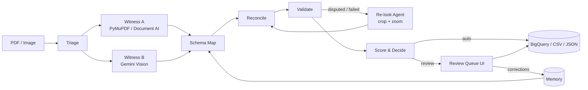

# RateProof — Architecture & Build Spec

> **PS-06 · Automated Data Extraction from Unstructured Documents (PDFs & Images)**
> Agentic pipeline that turns bank rate sheets (PDF, scans, photos) into validated, audit-ready records.
> **Tagline:** *Every number proves where it came from — and why it's right.*

Team: 2 engineers · Build window: 4 hours · Cloud: GCP · Coding assistants allowed

---

## 0. How to use this document

- Sections 1–3: what we are building and why it wins. Read once.
- Sections 4–12: the build spec. Each module has an owner, interface and acceptance check.
- Section 15: hour-by-hour plan and **cut order** if time runs short.
- Section 17: a ready prompt to hand to your coding assistant.

Priority tags used throughout: **P0** = must work end-to-end · **P1** = our innovation · **P2** = polish.

---

## 1. Problem → our answer

| Problem statement requirement | RateProof component | Priority |
|---|---|---|
| PDF & image ingestion, layout-aware OCR, table detection | `triage` + `witness_a` (PyMuPDF text layer for digital, Document AI Form Parser for scans/images) | P0 / P1 |
| LLM field extraction with schema mapping | `witness_b` (Gemini vision, structured output) + `schema_map` (header synonyms, unit normalization) | P0 |
| Business rule validation (range, format, cross-field) | `validators` — range, format, **financial physics**, term logic, cross-page | P0 |
| Confidence per field + human review queue | `reconcile` + `scoring` (evidence-based) + Review UI | P0 / P1 |
| CSV/JSON output with audit trail to source location | `persist` — every field carries file, page, bbox, raw text, witnesses, validator results | P0 |

### What makes it different (the pitch)

1. **Two independent witnesses.** Document AI (OCR + table structure) and Gemini (vision + semantics) read every page separately. Agreement is evidence; disagreement triggers investigation.
2. **Targeted re-look agent.** Only disputed or rule-failing fields are re-read: the agent crops that cell with padding, renders it at high resolution, and asks again with column context. Cheap and precise.
3. **Financial physics validation.** APY must satisfy `rate ≤ APY ≤ e^rate − 1`, and the implied compounding frequency is inferred. In the organizers' sample, **15 of the first 21 rows fail this check**.
4. **Extraction error ≠ document error.** If both witnesses and the re-look agree on a value that breaks physics, the record is labelled `DOCUMENT_INCONSISTENCY` — we never silently "fix" source data.
5. **Measured, not claimed.** Self-generated benchmark with ground truth + ablation table (each layer's contribution) + review-queue precision/recall.
6. **Correction memory (P2).** Reviewer fixes become header synonyms / few-shot hints for the same institution next time.

---

## 2. System architecture

```
 PDF / PNG / JPG
      │  (UI upload, API, or drop in bucket)
      ▼
 ┌──────────────────┐  Eventarc (P2)  ┌───────────────────────────────────────────────────────┐
 │ GCS  gs://<b>/inbox │──────────────▶│ Cloud Run: rateproof-api  (FastAPI)                     │
 └──────────────────┘                 │                                                       │
                                      │  per document → per page (asyncio fan-out)            │
                                      │                                                       │
                                      │  1 TRIAGE      type, text layer?, rotation, render PNG │
                                      │  2 WITNESS A   PyMuPDF words  |  Document AI tables    │
                                      │  3 WITNESS B   Gemini vision → rows + bbox per field   │
                                      │  4 SCHEMA MAP  normalize headers, units, dates         │
                                      │  5 RECONCILE   align A↔B by bbox, compare values       │
                                      │  6 VALIDATE    range · format · physics · cross-page   │
                                      │  7 RE-LOOK     crop+zoom disputed fields (≤2 loops)    │
                                      │  8 SCORE       field & row confidence                  │
                                      │  9 DECIDE      AUTO_APPROVED | NEEDS_REVIEW |          │
                                      │                DOCUMENT_INCONSISTENCY                  │
                                      │ 10 PERSIST     JSON/CSV + BigQuery + review queue      │
                                      └───────────┬───────────────────────────┬───────────────┘
                                                  │                           │
                                   ┌──────────────▼──────────┐   ┌────────────▼──────────────┐
                                   │ BigQuery  rateproof.*     │   │ Firestore                 │
                                   │ records · field_audit ·   │   │ review_queue · corrections│
                                   │ runs                      │   │ (fallback: local JSON)    │
                                   └──────────────┬──────────┘   └────────────┬──────────────┘
                                                  │                           │
                                     CSV / JSON export          Review UI (Streamlit, Cloud Run)
                                                                page image + bbox overlay,
                                                                approve / correct → memory
```

### Mermaid (for slides / README)



### Agent design decision

The pipeline is an **explicit state machine**, not a free-roaming LLM agent. The LLM is called at two well-defined points (Witness B, Re-look). The *agentic* behaviour is the loop: **observe (validators/reconcile) → decide which fields need another look → act (crop/zoom/re-read) → re-evaluate**, bounded at 2 iterations. This is deterministic, debuggable and demo-safe in 4 hours. (Google ADK can wrap it later; not needed for the finale.)

---

## 3. Tech stack

| Layer | Choice | Notes |
|---|---|---|
| Language | Python 3.11 | |
| API | FastAPI + uvicorn | `/extract`, `/batch`, `/records`, `/review` |
| UI | Streamlit | Fastest path to bbox overlay + review buttons |
| PDF render / text | PyMuPDF (`pymupdf`) | 200 dpi page render; `get_text("words")` for digital PDFs |
| OCR / tables | Google Cloud Document AI — **Form Parser** | Tables, cells, bbox, confidence. Region `us` or `eu` |
| LLM | Vertex AI Gemini via `google-genai` SDK | Model in env `GEMINI_MODEL`; use latest Flash available in your project (check Model Garden for exact ID) |
| Schemas | Pydantic v2 | Also used as Gemini `response_schema` |
| Images | Pillow, numpy, opencv-python-headless | Deskew, crop, synthetic scan effects |
| Synthetic PDFs | reportlab | Pure pip, no system deps |
| Storage | GCS, BigQuery, Firestore | Local filesystem fallback for every store |
| Deploy | Cloud Run (`gcloud run deploy --source`) | Cloud Run functions = "Cloud Functions" in the suggested stack |

`requirements.txt`

```
fastapi
uvicorn[standard]
python-multipart
pydantic>=2
google-genai
google-cloud-documentai
google-cloud-storage
google-cloud-bigquery
google-cloud-firestore
pymupdf
pillow
numpy
opencv-python-headless
reportlab
pandas
streamlit
python-dateutil
tenacity
```

---

## 4. Repository layout

```
rateproof/
├── ARCHITECTURE.md
├── requirements.txt
├── Dockerfile
├── .env.example
├── data/
│   ├── ps06_sample_rate_sheets.csv        # organizer data
│   └── bench/                             # generated: pdf/, png/, truth.jsonl
├── rateproof/
│   ├── config.py                          # env + feature flags
│   ├── models.py                          # Pydantic contracts (§5)
│   ├── pipeline.py                        # state machine orchestrator (§6)
│   ├── stages/
│   │   ├── triage.py
│   │   ├── witness_a.py                   # PyMuPDF words + Document AI tables
│   │   ├── witness_b.py                   # Gemini extraction
│   │   ├── schema_map.py                  # header synonyms + normalizers
│   │   ├── reconcile.py
│   │   ├── validators.py                  # rule catalog (§7)
│   │   ├── relook.py
│   │   └── scoring.py                     # confidence + decision (§8)
│   ├── io/
│   │   ├── storage.py                     # GCS / local
│   │   ├── bq.py                          # BigQuery / local CSV
│   │   └── memory.py                      # Firestore / local JSON
│   ├── prompts.py
│   └── geometry.py                        # bbox utils, IoU, crop
├── api/main.py                            # FastAPI
├── ui/app.py                              # Streamlit review UI
├── bench/
│   ├── generate.py                        # synthetic rate sheets (§11)
│   └── evaluate.py                        # metrics + ablation (§12)
└── tests/test_validators.py
```

---

## 5. Data contracts (`rateproof/models.py`)

```python
from enum import Enum
from typing import Optional, Literal
from pydantic import BaseModel, Field

# Coordinates: always normalized [x0, y0, x1, y1] in 0..1, origin top-left.
BBox = list[float]

class ProductType(str, Enum):
    SAVINGS = "Savings"
    HIGH_YIELD_SAVINGS = "High-Yield Savings"
    MONEY_MARKET = "Money Market"
    CHECKING = "Checking"
    CHECKING_PLUS = "Checking Plus"
    CD = "CD"
    IRA_CD = "IRA CD"
    OTHER = "Other"

TERM_PRODUCTS = {ProductType.CD, ProductType.IRA_CD}

class Decision(str, Enum):
    AUTO_APPROVED = "AUTO_APPROVED"
    NEEDS_REVIEW = "NEEDS_REVIEW"
    DOCUMENT_INCONSISTENCY = "DOCUMENT_INCONSISTENCY"

FIELDS = ["institution_name", "product_type", "term_months", "rate_pct",
          "apy_pct", "min_deposit", "effective_date"]

# ---------- Gemini output (Witness B) ----------
class GeminiField(BaseModel):
    raw: str = Field(description="Text exactly as printed, e.g. '3.55%' or '$1,000'")
    box_2d: list[int] = Field(description="[ymin, xmin, ymax, xmax] normalized 0-1000")

class GeminiRow(BaseModel):
    product_label: GeminiField          # product name as printed
    term: Optional[GeminiField] = None
    rate: Optional[GeminiField] = None
    apy: Optional[GeminiField] = None
    min_deposit: Optional[GeminiField] = None

class GeminiPage(BaseModel):
    institution_name: Optional[GeminiField] = None
    effective_date: Optional[GeminiField] = None
    column_headers: list[str] = []      # headers as printed, left→right
    footnotes: list[str] = []
    rows: list[GeminiRow] = []

# ---------- Evidence & audit ----------
class SourceRef(BaseModel):
    file: str
    page: int                           # 1-based
    bbox: Optional[BBox] = None
    raw_text: Optional[str] = None

class FieldEvidence(BaseModel):
    value: Optional[str | float | int] = None
    source: SourceRef
    witness_a: Optional[str] = None     # raw text from PyMuPDF / Document AI
    witness_a_conf: Optional[float] = None
    witness_b: Optional[str] = None     # raw text from Gemini
    agreement: float = 0.0              # 1 exact, 0.5 fuzzy, 0 disagree, 0.5 if only one witness
    grounded: bool = False
    relook_values: list[str] = []
    validators: dict[str, Literal["pass", "fail", "warn", "n/a"]] = {}
    confidence: float = 0.0

class Record(BaseModel):
    record_id: str
    source_file: str
    page: int
    institution_name: Optional[str] = None
    product_type: Optional[ProductType] = None
    term_months: Optional[int] = None
    rate_pct: Optional[float] = None
    apy_pct: Optional[float] = None
    min_deposit: Optional[float] = None
    effective_date: Optional[str] = None          # ISO yyyy-mm-dd
    inferred_compounding: Optional[str] = None    # daily|monthly|quarterly|semiannual|annual|none
    extraction_confidence: float = 0.0            # = row confidence (matches sample CSV column)
    needs_review: bool = True
    decision: Decision = Decision.NEEDS_REVIEW
    review_reasons: list[str] = []
    fields: dict[str, FieldEvidence] = {}
    pipeline: dict = {}                            # path, models, latency_ms, run_id, flags
```

**CSV output** = the sample CSV columns exactly (`source_file, institution_name, product_type, term_months, rate_pct, apy_pct, min_deposit, effective_date, extraction_confidence, needs_review`) **plus** `decision, review_reasons, inferred_compounding, record_id`. Judges can diff our CSV against theirs directly.

**JSON output** = full `Record` including `fields` (the audit trail).

---

## 6. Pipeline stages (`rateproof/pipeline.py`)

```python
async def process_document(path: str, flags: Flags) -> list[Record]:
    pages = triage(path)                                   # list[PageCtx]
    results = await asyncio.gather(*(process_page(p, flags) for p in pages))
    records = [r for page_records in results for r in page_records]
    cross_page_validate(records)                           # dates, duplicates, rate jumps
    for r in records: score_and_decide(r)
    persist(records)
    return records
```

Per page:

```
ctx = render(page)                          # PNG @200dpi, words (if digital)
A   = witness_a(ctx)        if flags.witness_a     # cells with bbox/conf
B   = witness_b(ctx, hints=memory.hints(institution))
rows = schema_map(B, headers, memory)       # → Record drafts with FieldEvidence
reconcile(rows, A)                          # agreement + grounding per field
validate(rows)                              # per-row rules
for loop in range(2):                        if flags.relook
    targets = fields where agreement < 1 or a HARD rule failed
    if not targets: break
    relook(targets, ctx)                    # crop+zoom → new readings
    reconcile(...); validate(...)
```

### 6.1 Triage (`stages/triage.py`) — P0

- Input: `.pdf`, `.png`, `.jpg`, `.jpeg`, `.tif`.
- PDF: for each page, `page.get_text("words")`; if ≥ 20 words → `kind="digital"` else `"scanned"`. Render with `page.get_pixmap(dpi=200)`.
- Image: `kind="image"`; auto-orient with EXIF, deskew (OpenCV `minAreaRect` on thresholded text) if |angle| > 0.5°.
- Output `PageCtx(file, page_no, kind, png_bytes, width, height, words: list[(x0,y0,x1,y1,text)] normalized)`.

### 6.2 Witness A (`stages/witness_a.py`) — P0 digital / P1 Document AI

- **Digital PDF:** words from PyMuPDF are exact (confidence = 1.0). No API call → fastest path.
- **Scanned / image:** Document AI Form Parser.

```python
from google.cloud import documentai
client = documentai.DocumentProcessorServiceClient(
    client_options={"api_endpoint": f"{DOCAI_LOCATION}-documentai.googleapis.com"})
name = client.processor_path(PROJECT, DOCAI_LOCATION, DOCAI_PROCESSOR_ID)
res = client.process_document(request=documentai.ProcessRequest(
    name=name, raw_document=documentai.RawDocument(content=png_bytes, mime_type="image/png")))
doc = res.document
# doc.pages[i].tables[j].header_rows / body_rows → cells
# cell.layout.text_anchor.text_segments → slice doc.text
# cell.layout.bounding_poly.normalized_vertices → bbox
# cell.layout.confidence → OCR/table confidence
```

- Output: `list[Cell(text, bbox, conf, row_idx, col_idx, is_header)]` + `tokens` (page.tokens) for grounding.
- Send **PNG per page** (not whole PDF) so pages can run in parallel and coordinates match our render.

### 6.3 Witness B — Gemini (`stages/witness_b.py`) — P0

```python
from google import genai
from google.genai import types
client = genai.Client(vertexai=True, project=PROJECT, location=GEMINI_LOCATION)
resp = client.models.generate_content(
    model=GEMINI_MODEL,
    contents=[types.Part.from_bytes(data=png_bytes, mime_type="image/png"),
              EXTRACT_PROMPT.format(hints=hints)],
    config=types.GenerateContentConfig(
        temperature=0, response_mime_type="application/json",
        response_schema=GeminiPage))
page = GeminiPage.model_validate_json(resp.text)
```

`EXTRACT_PROMPT` (`prompts.py`):

```
You are reading one page of a bank or credit union deposit rate sheet.
Extract EVERY product row from EVERY rate table on the page.

Rules:
- Copy values EXACTLY as printed in `raw` (keep %, $, commas, footnote marks). Do not compute or correct anything.
- If a value is not printed for a row, omit that field. Never guess.
- `term` is the deposit term as printed (e.g. "12 Mo", "1 Year", "18-Month"); omit for non-term products.
- `rate` is the interest/dividend rate; `apy` is the Annual Percentage Yield. If only one percentage column exists, put it in the field its header names.
- `effective_date`: the date the rates take effect (often in a header or footer line like "Rates effective ...").
- `institution_name`: the bank or credit union name as printed.
- `box_2d` = [ymin, xmin, ymax, xmax] of the printed value, normalized to 0-1000.
- List `column_headers` exactly as printed, left to right, and any footnotes.
{hints}
```

`hints` (P2, from memory): e.g. `For "Metro Credit Union", the column "Dividend Rate" is the rate and "APY*" is the APY.`

Convert `box_2d` → our bbox: `[xmin/1000, ymin/1000, xmax/1000, ymax/1000]`.

### 6.4 Schema map & normalizers (`stages/schema_map.py`) — P0

Header synonyms (extend at runtime from memory):

```python
HEADER_SYNONYMS = {
  "rate_pct": ["rate", "interest rate", "dividend rate", "int. rate", "nominal rate"],
  "apy_pct": ["apy", "annual percentage yield", "apy*", "yield", "annual yield"],
  "min_deposit": ["minimum", "min. deposit", "minimum balance", "min to open",
                  "minimum opening deposit", "balance to earn apy"],
  "term_months": ["term", "maturity", "length"],
  "product_type": ["product", "account", "account type", "deposit type"],
}
PRODUCT_SYNONYMS = {
  "share certificate": "CD", "certificate": "CD", "certificate of deposit": "CD", "cd": "CD",
  "ira certificate": "IRA CD", "ira cd": "IRA CD",
  "money market": "Money Market", "mma": "Money Market",
  "high yield savings": "High-Yield Savings", "high-yield savings": "High-Yield Savings",
  "savings": "Savings", "share savings": "Savings", "regular savings": "Savings",
  "checking plus": "Checking Plus", "interest checking": "Checking", "checking": "Checking",
}
```

Normalizers (pure functions, unit-tested):

```python
def parse_pct(s) -> float | None:     # "3.55%", "3.550 %", "3.55*" -> 3.55
def parse_money(s) -> float | None:   # "$1,000", "1K", "$25k", "None", "No minimum", "$0" -> number
def parse_term(s) -> int | None:      # "12 Mo", "1 Year", "18-Month", "6 mos", "365 days", "N/A", "" -> months (0 for none)
def parse_date(s) -> str | None:      # "7/1/2026", "July 1, 2026", "2026-07-01", "Effective 07/01/26" -> "2026-07-01"
def map_product(s) -> ProductType     # fuzzy (lowercase, strip marks) via PRODUCT_SYNONYMS, else OTHER
```

Rules:
- Use `dateutil.parser.parse(..., dayfirst=False, fuzzy=True)` — sample uses US M/D/YYYY.
- `term_months` for non-term products = `0` (matches sample convention).
- Page-level `institution_name` and `effective_date` are copied into each row's evidence (same source ref).
- If `institution_name` missing on page, fall back to filename slug (`summit_trust_rates_page4.pdf` → "Summit Trust") and mark `agreement=0.5`, add reason `INSTITUTION_FROM_FILENAME`.

### 6.5 Reconcile (`stages/reconcile.py`) — P1

For each field with a Gemini bbox:

1. **Find Witness A reading:** Document AI cell (or PyMuPDF words) whose bbox overlaps the Gemini bbox best — `IoU ≥ 0.2` **or** cell center inside Gemini bbox expanded by 30%. Concatenate overlapping words for digital PDFs.
2. **Compare normalized values** (same parser for both):
   - numeric: equal within `1e-6` → `agreement = 1.0`; differ only by rounding at printed precision → `0.5`; else `0.0`
   - text: case/space-insensitive equal → `1.0`; Levenshtein ratio ≥ 0.85 → `0.5`; else `0.0`
   - only one witness has a reading → `0.5`
3. **Grounding:** `grounded = True` if the normalized Gemini value appears in Witness A text inside the (padded) bbox.
4. Store `witness_a`, `witness_a_conf`, `witness_b`, `agreement`, `grounded` in `FieldEvidence`.

If Document AI finds a table row that Gemini missed (no Gemini field overlaps any cell of that row) → create a row draft from Witness A cells with `agreement=0.5` and reason `ROW_ONLY_IN_WITNESS_A`. This catches LLM omissions.

### 6.6 Re-look agent (`stages/relook.py`) — P1

Trigger per field: `agreement < 1.0` **or** any HARD rule touching that field failed.

```
1. bbox = field bbox (or row bbox if missing); pad 20% each side, clamp to page
2. crop from a 400-dpi re-render of that page region
   (PyMuPDF: page.get_pixmap(dpi=400, clip=fitz.Rect(...)))  | images: upscale crop 3x with LANCZOS
3. also crop the column header region (same x-range, top of table) for context
4. Gemini call with RELOOK_PROMPT → {"raw": "...", "legible": true/false}
5. append to relook_values; re-run reconcile for this field with 3 readings:
   - majority of {A, B, relook} wins → agreement = 1.0 if 3/3, 0.67 if 2/3
   - no majority → agreement = 0, reason FIELD_UNRESOLVED
```

`RELOOK_PROMPT`:

```
The first image is a zoomed crop of one cell from a bank rate table.
The second image shows the column header above it: "{header}". The row is "{product_label}".
Two earlier readings disagreed or failed validation: {readings}.
Read the value in the cell character by character, exactly as printed. Do not compute or correct.
Return JSON: {"raw": "<value as printed>", "legible": true|false}
```

Loop max 2 times. Log each attempt in `pipeline.relook_log` for the UI.

---

## 7. Validator catalog (`stages/validators.py`) — P0

Each rule returns `(status, reason_code, message)`; severity decides impact.

| Code | Field(s) | Rule | Severity |
|---|---|---|---|
| `RANGE_RATE` | rate_pct | `0 ≤ rate ≤ 15` | HARD |
| `RANGE_APY` | apy_pct | `0 ≤ apy ≤ 15` | HARD |
| `RANGE_MIN_DEPOSIT` | min_deposit | `0 ≤ x ≤ 10,000,000` | HARD |
| `RANGE_TERM` | term_months | `0 ≤ term ≤ 120` and integer | HARD |
| `FORMAT_DATE` | effective_date | parses to ISO date | HARD |
| `DATE_PLAUSIBLE` | effective_date | within [today − 3y, today + 1y] | SOFT |
| `PRODUCT_KNOWN` | product_type | not `OTHER` | SOFT |
| `MISSING_REQUIRED` | all | institution, product, rate or apy, date present | HARD |
| `APY_GE_RATE` | rate, apy | `apy ≥ rate − 0.0005` | HARD |
| `APY_PHYSICS_MAX` | rate, apy | `apy ≤ (e^(rate/100) − 1)·100 + 0.0015` | HARD |
| `COMPOUNDING_MATCH` | rate, apy | some n ∈ {365, 12, 4, 2, 1} gives `|APY_n − apy| ≤ 0.006` | SOFT |
| `TERM_PRODUCT_CONSISTENT` | term, product | CD / IRA CD ⇒ term > 0; others ⇒ term = 0 | HARD |
| `DUPLICATE_ROW` | row | same (file, institution, product, term, date) twice | SOFT |
| `DATE_CONSISTENT_IN_DOC` | effective_date | all pages of same PDF share one date | SOFT |
| `RATE_JUMP` | rate | same institution+product+term across dates changes > 2× | SOFT |

Physics + compounding (tested on sample rows):

```python
import math
COMP = {"daily": 365, "monthly": 12, "quarterly": 4, "semiannual": 2, "annual": 1}

def apy_from_rate(rate_pct: float, n: int) -> float:
    r = rate_pct / 100
    return ((1 + r / n) ** n - 1) * 100

def apy_max(rate_pct: float) -> float:
    return (math.exp(rate_pct / 100) - 1) * 100

def check_apy(rate: float, apy: float):
    out = []
    out.append(("APY_GE_RATE", apy >= rate - 0.0005))
    out.append(("APY_PHYSICS_MAX", apy <= apy_max(rate) + 0.0015))
    best = min(COMP, key=lambda k: abs(apy_from_rate(rate, COMP[k]) - apy))
    matched = abs(apy_from_rate(rate, COMP[best]) - apy) <= 0.006
    return out, (best if matched else None)
```

Sample sanity check (first 21 rows of organizer data): 15 rows fail `APY_PHYSICS_MAX`, e.g. First National Bank Money Market, rate 1.076 → max possible APY 1.082, printed 1.162. Put this in `tests/test_validators.py` as a fixture.

Tolerances absorb 3-decimal rounding; tune them on the benchmark, not by eye.

---

## 8. Confidence & decision (`stages/scoring.py`) — P0 (simple) / P1 (full)

### Field confidence

```
field_conf = 0.35·agreement
           + 0.20·ocr_conf          (Witness A conf; 1.0 for digital words; 0.6 if absent)
           + 0.20·grounded          (1/0)
           + 0.25·validation_score  (1 all pass, 0.5 any SOFT fail, 0 any HARD fail on this field)
```

P0 fallback (no Witness A yet): `field_conf = 0.5·validation_score + 0.5·(1 if value parsed else 0)`.

### Row confidence & decision

```
row_conf = min(field_conf over present fields)
extraction_confidence = round(row_conf, 2)

if any HARD rule failed:
    if every field in that rule has agreement == 1.0 after re-look (all witnesses agree):
        decision = DOCUMENT_INCONSISTENCY      # source document itself is wrong
    else:
        decision = NEEDS_REVIEW                # we may have misread
elif row_conf < TAU:
    decision = NEEDS_REVIEW
else:
    decision = AUTO_APPROVED

needs_review = decision != AUTO_APPROVED
review_reasons = sorted reason codes + human message, e.g.
  "APY_PHYSICS_MAX: printed APY 1.162% exceeds max possible 1.082% for rate 1.076%"
```

`TAU` default `0.80`; tune in §12 to maximise review recall at ≤ 25% review rate.

---

## 9. Storage

### 9.1 GCS layout

```
gs://$BUCKET/inbox/<file>                    # uploads (Eventarc trigger P2)
gs://$BUCKET/pages/<doc_id>/p<N>.png         # rendered pages (for UI overlay)
gs://$BUCKET/crops/<record_id>/<field>_<k>.png  # re-look crops (shown in UI)
gs://$BUCKET/out/<run_id>/records.csv
gs://$BUCKET/out/<run_id>/records.jsonl
```

Local fallback: same paths under `./data/store/`. Controlled by `STORE=local|gcp`.

### 9.2 BigQuery dataset `rateproof`

`records`

| column | type |
|---|---|
| record_id | STRING |
| run_id | STRING |
| source_file | STRING |
| page | INT64 |
| institution_name | STRING |
| product_type | STRING |
| term_months | INT64 |
| rate_pct | FLOAT64 |
| apy_pct | FLOAT64 |
| min_deposit | FLOAT64 |
| effective_date | DATE |
| inferred_compounding | STRING |
| extraction_confidence | FLOAT64 |
| needs_review | BOOL |
| decision | STRING |
| review_reasons | STRING (REPEATED) |
| reviewed_by | STRING |
| processed_at | TIMESTAMP |

`field_audit` (one row per field per record)

| column | type |
|---|---|
| record_id, run_id, field | STRING |
| value | STRING |
| source_file | STRING |
| page | INT64 |
| bbox | FLOAT64 (REPEATED) |
| raw_text, witness_a, witness_b | STRING |
| witness_a_conf, agreement, confidence | FLOAT64 |
| grounded | BOOL |
| relook_values | STRING (REPEATED) |
| validators_json | STRING |

`runs` — `run_id, started_at, finished_at, docs, pages, records, auto_approved, needs_review, doc_inconsistency, mean_latency_ms, est_cost_usd, flags_json`.

Load with `load_table_from_json` at end of run (no streaming needed).

### 9.3 Firestore

- `review_queue/{record_id}` → record JSON + `status: open|approved|corrected`, `assigned_to`.
- `corrections/{auto}` → `{institution, field, wrong, right, header_as_printed, ts}`.
- `memory/{institution_slug}` → `{header_synonyms: {...}, notes: [...]}` built from corrections → injected as `hints`.

Local fallback: `data/store/review_queue.json`, `data/store/memory.json`.

---

## 10. API (`api/main.py`)

| Method | Path | Body / params | Returns |
|---|---|---|---|
| POST | `/extract` | multipart `file`, query flags (`witness_a`, `relook`, `validators`) | `list[Record]` |
| POST | `/batch` | `{"gcs_prefix": "gs://.../bench/", "flags": {...}}` | `run_id` (async), poll `/runs/{id}` |
| GET | `/runs/{run_id}` | – | run metrics |
| GET | `/records` | `run_id`, `decision` | records |
| GET | `/records/{id}/export` | `fmt=csv|json` | file |
| GET | `/review` | – | open review items |
| POST | `/review/{record_id}` | `{"action":"approve"|"correct","field":..., "value":...}` | updated record; writes `corrections` + memory |
| POST | `/events/gcs` | Eventarc CloudEvent | triggers processing (P2) |
| GET | `/healthz` | – | ok |

**Access:** open. No authentication or authorization on any endpoint or in the UI; both Cloud Run services deploy with `--allow-unauthenticated`. Anyone with the URL can upload, review, correct and export, so use only synthetic or public rate sheets.

Concurrency: `asyncio.Semaphore(PAGE_CONCURRENCY)` (default 8) around each page; run sync SDK calls in `asyncio.to_thread`. Retry Gemini/DocAI with `tenacity` (3 attempts, exponential backoff) on 429/5xx.

---

## 11. Synthetic benchmark generator (`bench/generate.py`) — P0

Organizers provide only the extracted CSV, not raw documents. We render the CSV back into realistic rate sheets so we have ground truth.

1. Load `ps06_sample_rate_sheets.csv`; group by `source_file` → one page per group (multiple product rows per page).
2. Pick one of **4 templates** deterministically by `hash(source_file) % 4`:

| Template | Variation |
|---|---|
| T1 Classic | Columns: Product · Term · Rate · APY · Minimum. Date in header. |
| T2 Credit union | "Dividend Rate", "APY*", "Min. to Open"; terms as "12 Mo"; footnote `*APY accurate as of …` holds effective date in footer |
| T3 Grouped | Two tables: "Savings & Money Market" and "Certificates"; term column only in second; money as "$1K" |
| T4 Dense | Column order APY before Rate; "Annual Percentage Yield"; terms "1 Year"/"6-Month"; zebra stripes, small font |

3. Render each page with reportlab → `bench/pdf/<source_file>`.
4. Produce degraded variants → `bench/png/<stem>__scan.png`, `<stem>__photo.jpg`:
   - scan: 150 dpi, rotate ±2.5°, Gaussian blur σ 0.6–1.0, salt-pepper noise 0.5%, JPEG q=55
   - photo: perspective warp (4 corners ±3%), brightness gradient, JPEG q=45
5. Write `bench/truth.jsonl` — **what was actually printed** for each row (after template formatting/rounding), plus `variant`, `template`, and the physics label (`doc_inconsistent = APY_PHYSICS_MAX fails on printed values`).
6. Optional error injection (5% of rows, labelled in truth): swap rate/apy, drop a digit, wrong term for CD — measures detection recall of rules that are not physics-based.

Ignore the CSV's own `extraction_confidence` / `needs_review` as ground truth — they do not follow a consistent rule (e.g. 0.60 → FALSE, 0.91 → TRUE). Report it as a finding.

---

## 12. Evaluation (`bench/evaluate.py`) — P0

Row matching: by `(source_file stem, product_type, term_months)`; leftover rows matched greedily by min field distance; unmatched truth = missed row, unmatched prediction = spurious row.

| Metric | Definition |
|---|---|
| Field accuracy | exact match after normalization, per field and macro-average |
| Row exact match | all 7 fields correct |
| Row recall / precision | matched rows / truth rows, matched / predicted |
| Auto-approve rate | AUTO_APPROVED / predicted |
| **Review precision** | flagged rows that truly have ≥ 1 wrong field or are doc-inconsistent / flagged rows |
| **Review recall** | problem rows that were flagged / all problem rows |
| Silent error rate | AUTO_APPROVED rows with any wrong field / AUTO_APPROVED (target: ~0) |
| Inconsistency detection | precision/recall of `DOCUMENT_INCONSISTENCY` vs physics label |
| Throughput | pages/min, p50/p95 latency per page |
| Cost | est. USD per page (Gemini tokens + Document AI pages) |

All metrics split by variant: **digital · scan · photo**.

### Ablation (run with feature flags)

```
python -m bench.evaluate --flags gemini_only
python -m bench.evaluate --flags +validators
python -m bench.evaluate --flags +validators,+witness_a
python -m bench.evaluate --flags +validators,+witness_a,+relook      # full
```

Output `bench/report.md` + `bench/report.json` with the table below — this is the key slide:

| Pipeline | Field acc. | Auto-approve | Review recall | Silent errors | Pages/min |
|---|---|---|---|---|---|
| Gemini single pass | | | | | |
| + Validators | | | | | |
| + Witness A (Doc AI) | | | | | |
| + Re-look (full) | | | | | |

Fill only with real numbers from the run.

---

## 13. Review UI (`ui/app.py`) — P1

- **Upload tab:** drop PDF/image → calls `/extract` → shows records table coloured by decision (green / amber / red).
- **Record view:** left = page image with all field bboxes drawn (Pillow); selected field highlighted. Right = field table: value, witness A, witness B, re-look crops (thumbnails), validator results, confidence bar, reason messages.
- **Review queue tab:** open items sorted by confidence ascending; buttons **Approve** / **Correct** (inline edit) → `POST /review/{id}`.
- **Benchmark tab:** renders `bench/report.json` (ablation table + per-variant accuracy).
- **Export:** download CSV / JSON for the current run.

Keep it to one file; use `st.session_state` for selection.

---

## 14. GCP setup

```bash
export PROJECT=<project-id>
export REGION=us-central1
export BUCKET=${PROJECT}-rateproof
gcloud config set project $PROJECT

gcloud services enable aiplatform.googleapis.com documentai.googleapis.com \
  run.googleapis.com storage.googleapis.com bigquery.googleapis.com \
  firestore.googleapis.com cloudbuild.googleapis.com artifactregistry.googleapis.com \
  eventarc.googleapis.com

gcloud storage buckets create gs://$BUCKET --location=$REGION
bq mk --dataset --location=US ${PROJECT}:rateproof
gcloud firestore databases create --location=$REGION          # skip if one exists

# Document AI Form Parser processor (or create it in Console → Document AI → Form Parser)
curl -s -X POST \
  -H "Authorization: Bearer $(gcloud auth print-access-token)" \
  -H "Content-Type: application/json" \
  -d '{"type":"FORM_PARSER_PROCESSOR","displayName":"rateproof-form"}' \
  "https://us-documentai.googleapis.com/v1/projects/$PROJECT/locations/us/processors"
# copy the processor id from the "name" field into DOCAI_PROCESSOR_ID

# Local dev auth
gcloud auth application-default login
```

Deploy:

```bash
gcloud run deploy rateproof-api --source . --region $REGION \
  --allow-unauthenticated --memory 2Gi --cpu 2 --concurrency 20 --timeout 600 \
  --set-env-vars PROJECT=$PROJECT,BUCKET=$BUCKET,STORE=gcp,GEMINI_MODEL=$GEMINI_MODEL,GEMINI_LOCATION=$GEMINI_LOCATION,DOCAI_LOCATION=us,DOCAI_PROCESSOR_ID=$DOCAI_PROCESSOR_ID
```

The Cloud Run service account needs: `roles/aiplatform.user`, `roles/documentai.apiUser`, `roles/storage.objectAdmin`, `roles/bigquery.dataEditor`, `roles/bigquery.jobUser`, `roles/datastore.user`.

Eventarc (P2):

```bash
gcloud eventarc triggers create rateproof-inbox --location=$REGION \
  --destination-run-service=rateproof-api --destination-run-path=/events/gcs \
  --event-filters="type=google.cloud.storage.object.v1.finalized" \
  --event-filters="bucket=$BUCKET" \
  --service-account=<run-sa>@$PROJECT.iam.gserviceaccount.com
```

(The GCS service agent needs `roles/pubsub.publisher`; if the trigger fights you, skip it — the API path is enough for the demo.)

`Dockerfile`

```dockerfile
FROM python:3.11-slim
WORKDIR /app
COPY requirements.txt .
RUN pip install --no-cache-dir -r requirements.txt
COPY . .
CMD exec uvicorn api.main:app --host 0.0.0.0 --port ${PORT:-8080}
```

UI: deploy the same image as a second service with `CMD streamlit run ui/app.py --server.port $PORT --server.address 0.0.0.0` and `API_URL` env var, or run Streamlit locally for the demo.

### `.env.example`

```
PROJECT=
BUCKET=
STORE=local                 # local | gcp
GEMINI_MODEL=               # latest Flash ID available in your project
GEMINI_LOCATION=us-central1 # some newer models require "global"
DOCAI_LOCATION=us
DOCAI_PROCESSOR_ID=
TAU=0.80
PAGE_CONCURRENCY=8
FLAG_WITNESS_A=true
FLAG_VALIDATORS=true
FLAG_RELOOK=true
FLAG_MEMORY=true
```

---

## 15. Build plan (4 hours, 2 people)

**A = agent / AI owner · B = data / infra / UI owner**

| Time | A | B | Done when |
|---|---|---|---|
| 0:00–0:20 | `models.py`, `config.py`, `prompts.py`, Gemini hello-world on one image | GCP setup (§14), Doc AI processor, bucket, ADC; repo skeleton | Gemini returns `GeminiPage` JSON |
| 0:20–1:15 | `triage`, `witness_b`, `schema_map` + normalizer tests, `validators` + tests | `bench/generate.py`: 4 templates, scan/photo variants, `truth.jsonl` | 1 PDF → records CSV locally; ≥ 40 bench pages generated |
| 1:15–2:00 | `witness_a` (PyMuPDF + Doc AI), `reconcile`, `scoring` | `bench/evaluate.py` + first baseline run (`gemini_only`, `+validators`) | First metrics table printed |
| 2:00–2:40 | `relook` loop + crops saved | `ui/app.py`: upload, overlay, review queue, export | Disputed field visibly resolves in UI |
| 2:40–3:20 | Full ablation run, tune `TAU`, fix top 3 failure types | Cloud Run deploy, BigQuery load, (Eventarc if green) | Public URL works; report.md filled |
| 3:20–4:00 | **Feature freeze.** 5 slides, backup screen recording, 2 rehearsals | | |

**Cut order if behind** (cut top first):
1. Eventarc trigger
2. Firestore → local JSON
3. BigQuery → CSV/JSON only
4. Correction memory
5. Document AI → use a second Gemini call with a different prompt (“read the table as markdown grid”) as Witness A

**Never cut:** validators, re-look loop, benchmark + ablation, audit trail in JSON.

Checkpoints: at **1:15** one document must flow end-to-end; at **2:40** freeze new features if the full benchmark has not run yet.

---

## 16. Demo script (3 minutes)

1. **Problem (20s):** manual rate-sheet entry is slow; OCR loses table structure and never checks values.
2. **Live (60s):** upload a phone photo of a rate sheet → table rows appear → one APY field amber (witnesses disagree) → re-look crop shown → turns green. Click a field → highlighted on the page.
3. **The catch (30s):** *"Our physics validator flagged 15 of the first 21 rows in the sample data — the printed APY is higher than mathematically possible for that rate."* Show the record's reason message. Explain extraction error vs document error.
4. **Proof (40s):** ablation table + review precision/recall + silent error rate.
5. **Production (30s):** drop file in bucket → BigQuery row with full field audit; correction memory; cost per page; Cloud Run scaling.

Backup: pre-recorded video + cached run results in case of network/API failure.

---

## 17. Risks & mitigations

| Risk | Mitigation |
|---|---|
| Gemini bbox slightly off | 20% padding, center-in-cell matching, IoU ≥ 0.2 |
| Model ID / region not available | `GEMINI_MODEL`, `GEMINI_LOCATION` env; test in first 20 min |
| Document AI quota/setup delay | Cut-order item 5 (second Gemini witness) |
| Rate limits during benchmark | Semaphore + tenacity backoff; benchmark ≤ 60 pages |
| Synthetic data easier than real | Say so on the slide; show 2–3 real public rate sheets too |
| Live demo failure | Cached results + recording |

---

## 18. Starter prompt for the coding assistant

```
You are implementing RateProof per ARCHITECTURE.md in this repo. Follow the module layout in §4,
data contracts in §5 exactly, and the stage behaviour in §6–§8. Use Python 3.11, Pydantic v2,
google-genai (Vertex mode), google-cloud-documentai, PyMuPDF. All coordinates normalized 0..1
[x0,y0,x1,y1]. Every store must have a local fallback (STORE=local). Feature flags from config.py
must be able to switch off witness_a, validators and relook for the ablation in §12.
Start with: models.py, config.py, stages/schema_map.py normalizers with pytest tests, and
stages/validators.py with tests using these sample rows:
(rate 1.076, apy 1.162 → APY_PHYSICS_MAX fail), (rate 3.998, apy 4.057 → pass, compounding detected).
Keep functions small and pure; no network calls in tests.
```
