# BeeProof AI

BeeProof turns bank rate sheets (PDF, scans, and photos) into validated records. Every value keeps its source region, the readings of two independent witnesses, the rules it passed or failed, and its review history.

Public app: [https://proof.beeneural.com](https://proof.beeneural.com)

## Product

The workspace is one Next.js app. Navigation is a hash route (`#overview`, `#documents`, `#review`, and so on), so a document review stays on a single page and the API base URL can be pointed at a local or production backend.

### Overview

The home view counts documents, structured records, rules that passed, and rows still waiting on a human. Upload starts from here.

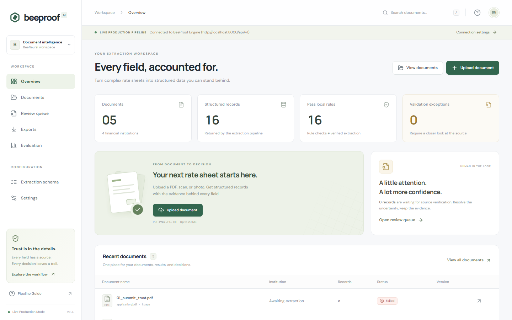

### Documents

The library lists every upload with institution, record count, job status, and result version. Open a row to inspect the source page next to the extracted fields.

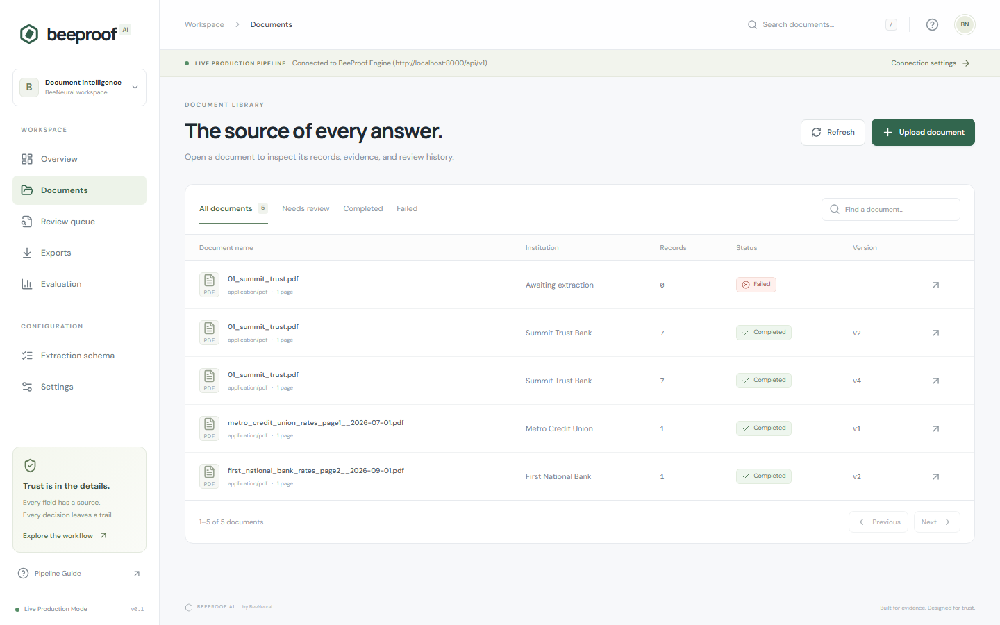

### Records and evidence

A finished job shows the source page beside each field. Selecting a field highlights the region it was read from. Witness agreement, validation, and the action timeline sit on the same document.

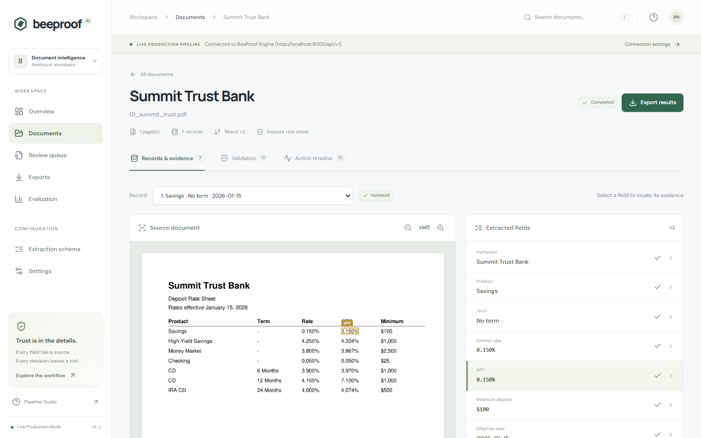

### Review queue

Rows that are not auto-accepted land here. A blocking validation failure cannot be overridden by accepting the field. Corrections are revalidated.

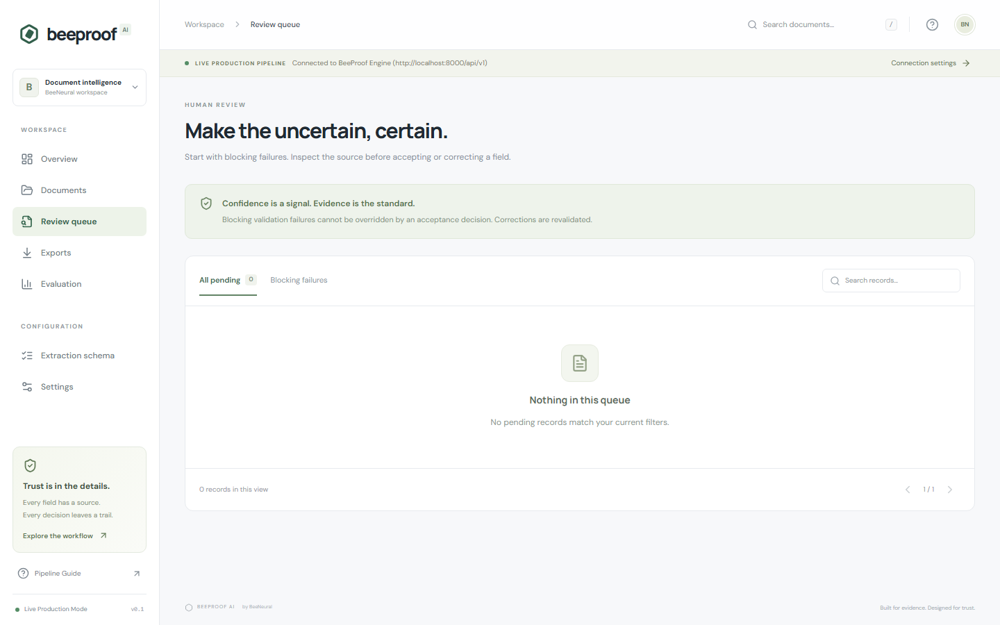

### Extraction schema

Jobs are pinned to a published schema version. The deposit rate sheet schema is the field contract: institution, product, term, rate, APY, minimum deposit, and effective date.

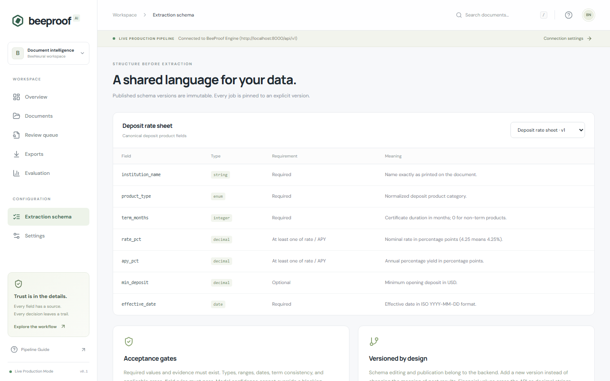

### Exports

JSON keeps field evidence. CSV keeps stable columns and an explicit review status. An export is tied to one result version.

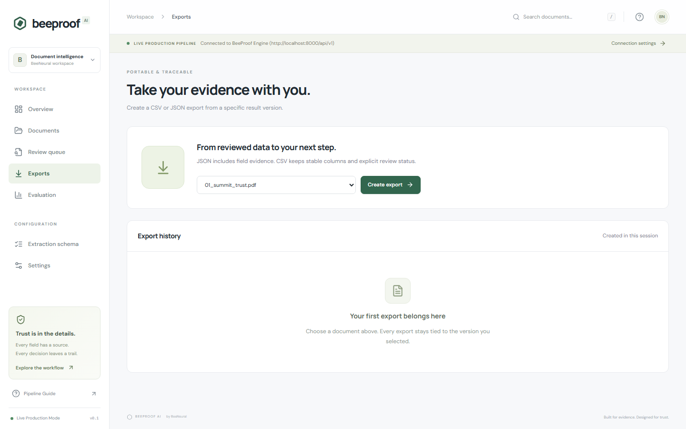

### Evaluation

Benchmarks compare three pipelines on the same labeled corpus: native text or OCR, a single-pass LLM, and evidence-first extraction with bounded repair. Metric cells stay empty until a benchmark report supplies matched denominators.

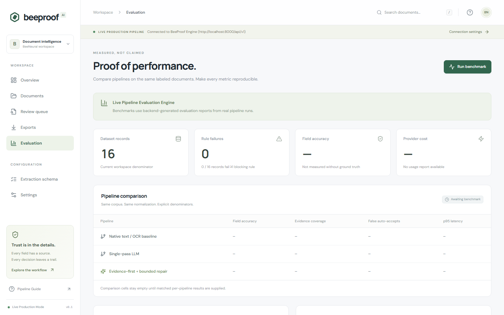

### Settings

The UI talks to whatever API base URL is saved here. Upload limits, repair attempts, and the evidence requirement are enforced by the backend.

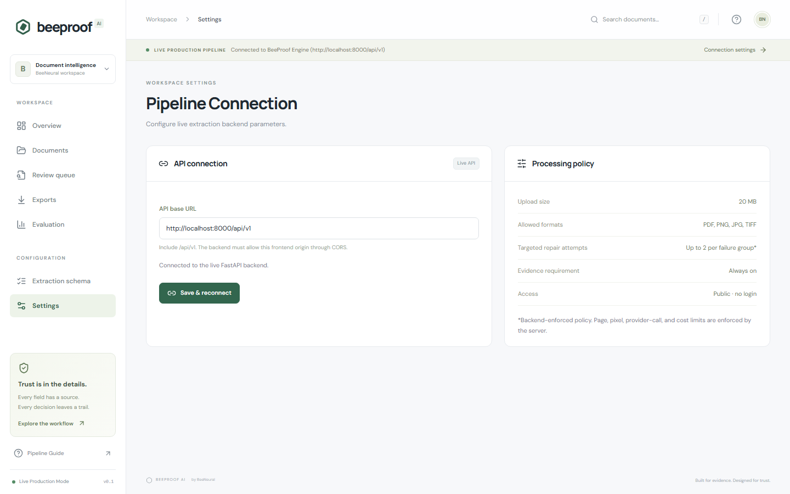

## Architecture

### Production path

The browser never calls Cloud Run directly. Cloudflare terminates TLS, the tunnel connector on a private VM forwards to an internal load balancer, and that balancer sends `/api` to the API and every other path to the web app. The worker has no public route.

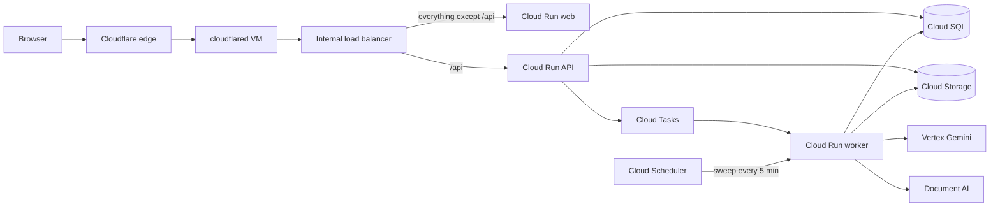

| Piece | What it does |
|---|---|
| Web | Next.js UI. Ingress is internal. |
| API | FastAPI. Creates jobs and serves results. The API process does not run extraction. |
| Worker | Claims a job, runs the pipeline, writes records and traces. Invoked only with Cloud Tasks or Scheduler identity. |
| Migrate | One-shot Cloud Run job. Applies Alembic before a deploy shifts traffic. |
| Cloud Tasks | Rate-limits extraction. Lost deliveries are recovered by the sweep. |
| Cloud SQL | PostgreSQL 16 on a private IP. Job state lives here, not in the queue. |
| Cloud Storage | Private bucket for original files and page previews. |
| Gemini | Witness B. Structured extraction from the page image. |
| Document AI | Witness A for scans. Digital PDFs use the text layer instead. |

### Request path for one document

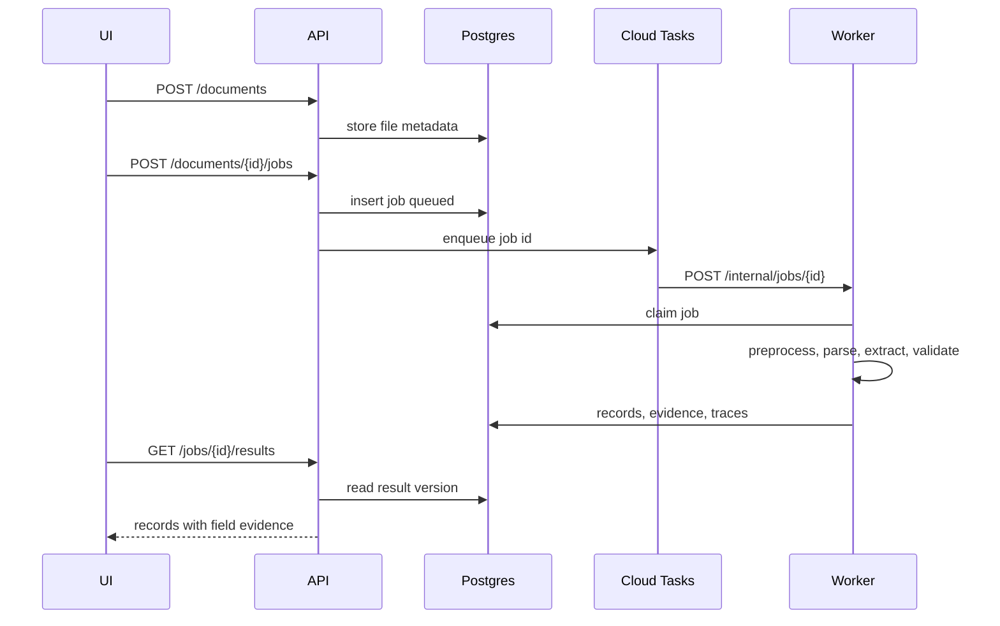

Local Docker uses Redis instead of Cloud Tasks. The job row in Postgres is still the source of truth. Workers `BRPOP` the job id and claim it with a conditional update.

### Extraction pipeline

Two witnesses read the same page. Neither one is allowed to invent a value the other cannot ground. Deterministic rules run after both readings exist. A bounded re-look may crop the disagreed region and ask again, then the same rules run once more. The acceptance gate decides auto-approve, needs-review, or document inconsistency.

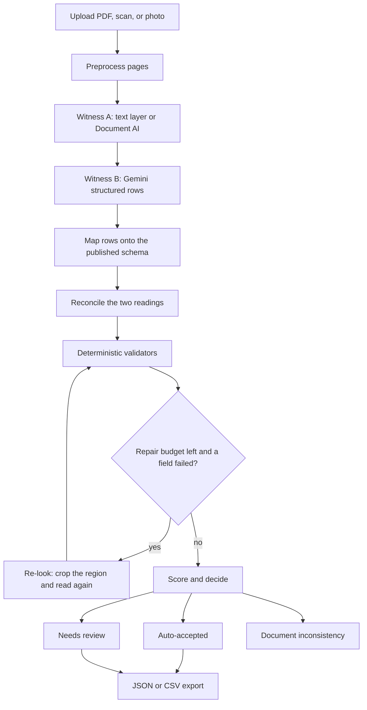

Witness A is PyMuPDF words on a digital PDF, and Document AI on a scan when a processor id is configured. Witness B is the configured Gemini model. With the heuristic extractor, image pages produce no rows and every record stays in review.

## Repository layout

| Path | Role |
|---|---|
| `app/`, `components/`, `lib/` | Next.js UI |
| `backend/` | FastAPI API, worker, pipeline, and backend tests |
| `docs/product/` | Product spec, API contracts, data model, ADRs |
| `docs/architecture.md` | Build specification for extraction, validation, and scoring |
| `docs/handoff.md` | Contract between the UI and the API |
| `docs/deployment/` | GCP, Cloudflare Tunnel, CI, rollback |
| `docs/images/` | Screenshots used in this README |
| `infra/` | Terraform |
| `scripts/` | Deploy, tunnel, and local smoke scripts |

## Run locally

From the repository root:

```bash
docker compose up --build
```

| Service | URL |
|---|---|
| UI | http://localhost:3000 |
| API docs | http://localhost:8000/docs |
| Postgres | localhost:5432 (`beeproof` / `beeproof` / `beeproof`) |
| Redis | localhost:6379 |

`docker compose down` stops the stack. `docker compose down -v` also deletes local data.

Backend-only setup, environment variables, and tests: [backend/README.md](backend/README.md).

## Tests

```bash
cd backend && .venv/Scripts/python -m pytest
npm test
npm run test:e2e
```

## Documentation

Start at [docs/README.md](docs/README.md). Production setup is [docs/deployment/README.md](docs/deployment/README.md).
